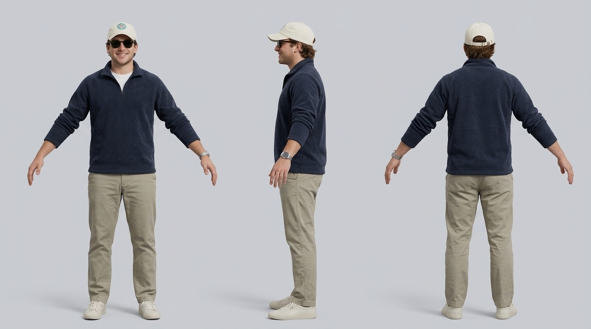
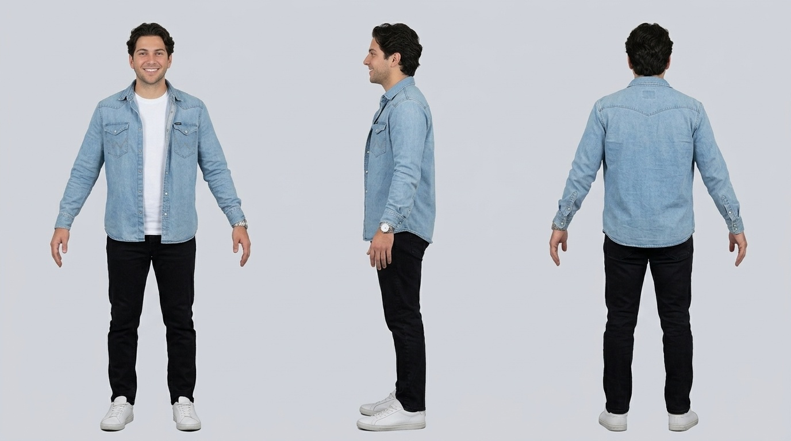
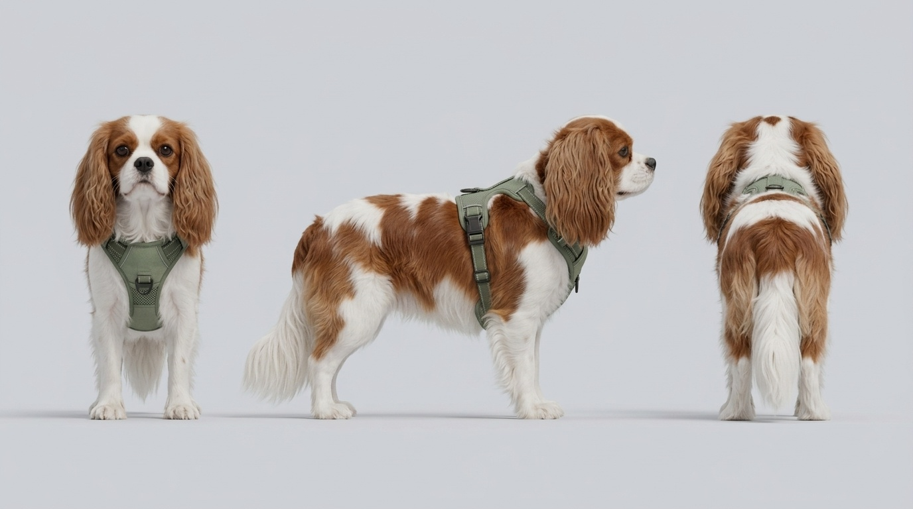

# Boat Guy & Cavalier — Interactive 3D Model & Photorealistic Turnaround Studio

Interactive WebGL2 stylized 3D character figurine + studio-lit photorealistic orthographic turnaround sheets (ready for Meshy, Tripo3D, Rodin, or Blender), complete with a Blenheim Cavalier King Charles Spaniel and teak boat-deck display pedestal.

### Live Interactive 3D Viewer
Open **[https://angeloscuderi1.github.io/boat-guy-3d/](https://angeloscuderi1.github.io/boat-guy-3d/)** to switch between:
- **Stylized 3D Model** — Animated WebGL2 PBR figurine with lake-wave boat rock, wagging dog tail, Cavalier head tilt, camera presets, **`Hat: On / Off`** toggle (revealing full middle-parted wavy brown hair), **`Sunglasses`** toggle, and instant **`.GLB`** / **`.STL`** export.
- **Photorealistic Turnaround Studio** — Switch between **Boat Outfit**, **Denim (Clear Face)**, and **Cavalier Dog** across **3-View Sheet**, **Turntable Scrub**, and **3D Intersecting Reference Planes**.

---

### Photorealistic 3D Turnaround Sheets




Individual cropped Front / Side / Back orthographic PNGs are in [`./turnarounds/`](./turnarounds/).

### 3D Mesh Exports (`./output/`)
- [`output/boat-guy-and-dog.glb`](./output/boat-guy-and-dog.glb) — glTF 2.0 binary with PBR materials
- [`output/boat-guy-no-cap.glb`](./output/boat-guy-no-cap.glb) — Hat-off / wavy-hair variant
- [`output/boat-guy-and-dog.stl`](./output/boat-guy-and-dog.stl) — Binary STL (~150 mm tall, Z-up) ready for 3D printing slicers

### Regenerating `.glb` and `.stl` Locally
```bash
node export.js
```
